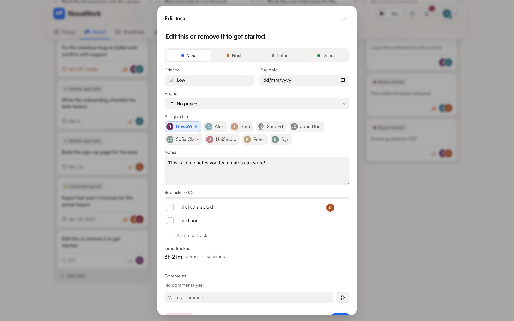
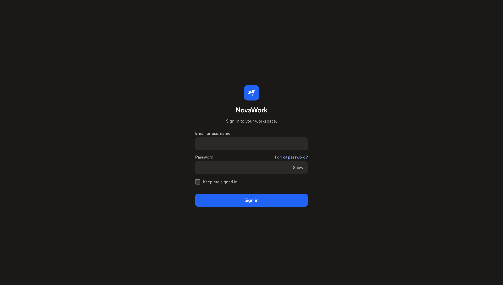
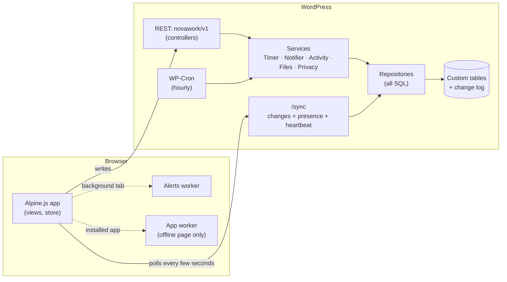

# NovaWork

**A calm team workspace that runs inside WordPress.** Projects, a board, a roadmap, decisions, a focus timer with time analytics, team chat and notifications, for teams of 2 to 10, on a WordPress site you already own. No subscription, no seat prices, no outside service.

It is deliberately *not* another everything-tool: few buttons, nothing to configure before the team can start, and a design that stays quiet so the work can be loud.


**[▶ Try the live demo](https://playground.wordpress.net/?mode=seamless&blueprint-url=https://raw.githubusercontent.com/unistudioco/novawork/main/demo/blueprint.json)**: a private copy of NovaWork in your browser, with a demo team and their work. Nothing to install, nothing you do reaches anyone else, and a reload starts fresh.

- **Free and complete.** GPLv2 or later, nothing locked, no Pro version of the core.
- **Yours.** Everything lives in your WordPress database and uploads folder. The app talks only to your own site.
- **Made to feel like a product**, not a plugin page: its own address, sign-in page, branding, light and dark mode, and a phone layout built for touch.

---

## Contents

[Features](#features) · [The small things](#the-small-things) · [Screenshots](#screenshots) · [Tech stack](#tech-stack) · [How it works](#how-it-works) · [Extending NovaWork](#extending-novawork) · [Install](#install) · [Development](#development) · [Releasing](#releasing) · [Roadmap](#roadmap) · [License and credits](#license-and-credits)

---

## Features

### Focus: your day on one page
- **Your three.** Each person keeps a short list in Now (three by default, a setting). Everything else waits in Next or Later.
- **One timer, one click.** Press play on any task; time is tracked on the server, so a reload or a second device never loses or double-counts it.
- **Team today**: who is here, what they are working on, how long they tracked today.
- **Due in the next three weeks** and **waiting on a decision**, beside your work.

### Work: board, subtasks, projects, roadmap
- A board with **Now, Next, Later and Done**; drag to reorder or move between columns.
- **Subtasks** as a checklist inside a task: tick, rename in place, give a step to a teammate, drag to reorder. Cards show progress such as `2/5`.
- Priorities, due dates, several assignees, notes and comments on every task.
- **Projects** with a goal, colour, start and target dates and a hard deadline, and a **roadmap** by months or quarters.

### Decide: decisions and votes
- Write down the questions that block work, with context and a date to decide by.
- **One person decides; votes advise.** Ask the team to vote on up to 8 options; the person named records the decision, with who and when.
- The options with the most votes rise to the top and glide to their new place as votes come in (or keep the order you wrote).

### Time
- Where the hours went: today, week, month or year, with the daily average, sessions, the top project and a breakdown by person.
- **Never loses time silently, never counts time nobody confirmed.** After a while without activity the timer asks "Still working?", also as a desktop or phone alert you can answer from any window. Fold the laptop, close the window or lose the connection, and it stops where the device went quiet; next time you're back it asks **"Were you working?"** and Count it puts the time back.
- **Works offline:** the timer keeps counting, and Stop is saved when the connection returns.
- **Administrators fix time by hand:** add a session, change its task and times, or delete it with Undo.

### Talk: chat, comments, notifications
- **Team chat** that docks to either side, floats anywhere, or opens as a sheet on phones; Shift+Enter for a new line.
- **@mentions** and **/links** to tasks, decisions and projects, in chat and comments. Reply, edit and delete, with Undo.
- **Private files** in chat: never in the Media Library, served only to signed-in members.
- **Notifications** in two tabs: *Mine* (assigned, mentioned, asked to vote, comments, due dates) and *Workspace* (the team's activity feed).
- **Desktop alerts** while the workspace is open in a background tab, turned on per device.
- **Quick search** across tasks, projects, decisions and the whole chat history.

### Your site, your workspace
- **Its own address** (`yoursite.com/novawork/`, any slug you like) or the home page of a site or subdomain; its own sign-in, reset and invite pages; an option to show only the workspace.
- **Your name, icon, logo and accent colour.** Every accent tone is derived and kept readable in light and dark.
- **Install it as an app** on Android, iPhone, iPad and desktop, with your icon and its own window, and a calm offline page. No app store.
- **Members are WordPress users.** Invite people with a link or by email, or tick "NovaWork member" on an existing user's profile. Nobody signs up on their own.
- **Members change their own work** (tasks they created or are assigned to, projects and decisions they created); administrators change everything. A setting opens it to the whole team.
- **Every choice an admin could want is a setting**, on a settings screen in NovaWork's own design inside wp-admin.

### Privacy and data
- Personal data export and erasure through WordPress's own tools; suggested privacy-policy text.
- An uninstall that removes everything only when you ask it to.
- Translation ready, in each member's own language.

---

## The small things

The details that make it feel finished:

| | |
|---|---|
| **Undo everywhere** | Deleting a task, project, decision, comment, message or subtask shows "Deleted. Undo", and Undo really brings it back. |
| **Live without websockets** | Changes reach everyone within seconds through one polling endpoint, so it works on ordinary shared hosting. |
| **Keyboard** | <kbd>N</kbd> new task · <kbd>/</kbd> search · <kbd>T</kbd> start or pause the timer · <kbd>Esc</kbd> closes whatever is open. |
| **Honest timer** | A heartbeat on the server plus a sleep check in the page: a folded laptop never keeps tracking, and "Were you working?" puts real work back. |
| **Flowing gradient** | The running timer's card, the tracked task's card and the phone's floating tracker share one animated ring (off with reduced motion). |
| **Phones** | Bottom sheets with swipe-to-close, a floating tracker, a create button, and a full-screen search. |
| **Dark mode** | Follows the device, with tokens tuned for both themes. |
| **First run** | Three sample items show where to start and leave in one click. |
| **Welcome tour** | A first visit walks through each page with a gliding spotlight; anyone can take it again from their menu (an admin can turn it off). |
| **Tooltips** | One smooth tooltip for icon buttons and the timer (with its <kbd>T</kbd> shortcut), above dialogs too; never on touch. |
| **Settings from the workspace** | Administrators open the settings screen from the team menu, no detour through wp-admin. |

---

## Screenshots

| Board with subtasks | A task |
|---|---|
|  |  |
| **Chat beside the work** | **Dark mode** |
|  |  |

All ten are in [`.wordpress-org/`](.wordpress-org); `node bin/screenshots.mjs` retakes them.

---

## Tech stack

| Layer | What | Why |
|---|---|---|
| Server | **PHP 8.1+**, typed, PSR-4 (Composer), WordPress Coding Standards | Runs on any modern WordPress host. |
| Platform | **WordPress 6.4+** (tested up to 7.1) | Users, roles, cron, privacy tools, i18n, REST. |
| Data | **Custom tables** via `dbDelta` with a schema version and migrations; every query through `$wpdb->prepare()` | Fast, indexed, and nothing mixed into posts. |
| API | **REST** under `novawork/v1`; cookie auth, nonce, capability and object-level checks on every route | One small, testable surface. |
| Sync | One **polling endpoint** (`GET /sync?since=`) over a change log; presence and the timer heartbeat ride on it | No websockets, no outside service. |
| Front end | **Alpine.js 3** + **Vite 8** (Rolldown) | A light reactive layer, no SPA framework. |
| Styles | **Plain CSS** with custom properties, ported token-for-token from the approved prototype | Exact design, easy to theme. |
| Icons and type | **Phosphor** icons (bundled), **Satoshi** and **Supreme** from Fontshare (optional) | |
| Quality | **PHPStan** level 6, **PHPCS**, **Plugin Check** on the release zip, **REST integration tests** (rolled back), **HTTP tests**, **Playwright** browser tests | Every change goes through the same gates. |

---

## How it works



- **Writes** go through REST controllers, which validate input and check both the capability and the object (who may change this decision?). Repositories hold all SQL and record every write in a **change log**.
- **Reads** come from `GET /sync`: a full snapshot the first time, then only what changed since the last cursor, plus members, presence, unread counts, settings and a fresh nonce.
- The **timer** lives on the server: its start time is stored, and each poll is a sign of life. A timer whose app goes quiet stops at the last sign of life.

Code map: `src/` (PHP: `App`, `Rest`, `Data`, `Services`, `Install`, `Access`, `Admin`), `assets/src/` (JS and CSS source), `views/` (the app, sign-in and settings documents), `tests/` (API, HTTP and browser tests).

---

## Extending NovaWork

NovaWork is built so an add-on can listen and act, including authors that are not people: an add-on can post in chat and comment under its own name, like a team member, and add its own buttons and settings without changing NovaWork's files.

### Hooks

Actions (`@since 1.0.0` unless noted):

- `novawork_loaded`: NovaWork has registered its parts; an add-on boots here.
- `novawork_task_created|updated`, `novawork_subtask_created|updated|deleted`, `novawork_project_created|updated`, `novawork_decision_created|updated|decided`, `novawork_comment_created|updated|deleted`, `novawork_message_created|updated|deleted`, `novawork_timer_started|stopped`, `novawork_time_entry_saved|deleted` (1.2.0), `novawork_member_joined`, `novawork_settings_saved`.
- `novawork_notification_created( array $note, int $user_id )` (1.3.0): a row was added to a member's bell (`$note` as the API presents it; not for a repeat a dedupe key stopped).
- `novawork_agent_mentioned( string $agent_key, string $kind, array $row )` (1.3.0): a message (`$kind` "message") or comment ("comment") mentions an agent with "@Name"; on an edit only for newly mentioned agents, and never for an agent's own post.
- `novawork_decision_assigned( array $decision, int $owner_id, string $owner_agent )` (1.3.0): a decision is opened with someone in "Who decides", or that changes.
- `novawork_read_moved( int $user_id, int $last_id, int $before, string $channel )` (1.3.0): a member's read position in the chat moved forward (they opened it, read new messages, or posted one); `$before` is where it was.
- `novawork_app_enqueue` (1.3.0): enqueue your scripts and styles on the workspace page. Only what is enqueued here is printed, after NovaWork's own; mark an ES-module build with `wp_script_add_data( $handle, 'novawork_module', true )`.

Filters:

- `novawork_agents`: register non-human authors, each `[ 'key', 'name', 'color' ]` (a NovaWork palette colour).
- `novawork_pro_link` (1.1.0): changes the Pro waitlist button on the settings screen and the link on NovaWork's row in Plugins (label, address, a dialog or a plain link) or hides both.
- `novawork_boot( array $addons, int $user_id )` (1.3.0): data for your script when the workspace opens, in `window.novawork.addons[ your key ]`.
- `novawork_sync( array $addons, int $user_id, bool $full )` (1.3.0): small, current data with every `/sync` answer, kept in the app's `store.addons[ your key ]`.
- `novawork_settings_schema( array $rules )` (1.3.0): rules for your own settings (`int` with `min`/`max`, `bool`, `choice` with `choices`, `text` with `max`, `types`, `image`, `color`), checked by `NovaWork\Settings::clean()` and `Settings::clean_values( $values, $only )` (clean values and errors by name, so one bad value can save nothing). NovaWork's own rules can't be replaced; your add-on stores its own values.
- `novawork_can_decide( bool $allowed, array $decision, int $user_id, string $agent )` (1.3.0): who may record a decision; `$agent` is set when an agent asks.

### Writing as a member or an agent (1.3.0)

`NovaWork\Api` takes the same path as the app's own requests: text cleaned, mentions and /links kept only when really in the text, open apps updated on their next poll, people notified, the same actions fired. An author is a member's user id or a registered agent's key.

- `Api::post_message( $author, $text, $args )`: `replyTo`, `mentions` (member ids), `agents` (agent keys), `refs`, `attachmentIds` (members only).
- `Api::post_comment( $author, $object_type, $object_id, $text, $args )` on a task or decision.
- `Api::notify( $user_id, $kind, $data, $author, $args )`: a bell row of your own kind (`objectType`, `objectId`, `dedupeKey`).

Errors come back as `WP_Error` with an HTTP status.

### In the app (1.3.0)

Once the app has started it fires `nw:ready` on `window`; the same object stays at `window.novawork.app` for a script that runs later. It holds `store` (live), `api` (`get`, `post`, `patch`, `del`, `nonce()` for NovaWork's REST routes), `ic`, `icf`, `esc`, `toast`, `__`, `sprintf`, and three places to add to:

- `addHeaderButton( { id, icon | svg, label, onClick, badge } )`: an icon button before the chat button; `badge()` may read the store and shows the unread dot.
- `addMenuItem( { id, icon | svg, label, onClick } )`: a row at the top of the team menu.
- `addNoteKind( kind, { icon, color, text( note, { b, esc, who } ), open( note ) } )`: the icon and wording of your notification kind, in the bell and in desktop alerts.
- `addMessageAction( { id, label, icon | svg + svgPressed, when( item, kind ), pressed( item, kind ), onClick( item, kind ) } )`: a button in the toolbar of chat messages and comments (`kind` is `message` or `comment`), after Reply, Edit and Delete. With `pressed()` it is a toggle (`aria-pressed`, the icon's fill weight or `svgPressed`); the list redraws once `onClick` returns.
- `setThreadStatus( where, text )`: a quiet line above the text field of the team chat (`where` = `'chat'`) or of one object's comments (`{ objectType, objectId }`), such as "Helper is thinking…". `null` clears it.
- `addPanel( { id, title, render( body ) } )` and `openPanel( id )`: a panel in the app's dialog style (a bottom sheet on phones), with the page behind it locked; `render()` draws it each time it opens.

Decisions can name an agent in "Who decides" (`ownerAgent`): the agent gives its advice and the person who opened the decision records it (administrators once that person is no longer a member). Agents appear in the @ suggestions in chat and comments.

### Settings screen (1.3.0)

A page under the NovaWork menu can look like NovaWork's settings: call `NovaWork\Admin\SettingsPage::enqueue_styles()` on `admin_enqueue_scripts` for that screen and put the page inside `class="nw-admin"`. The style handle is `novawork-admin`.

Rules may be `int` (`min`, `max`), `bool`, `choice` (`choices`), `text` (one line, `max`), `textarea` (several lines, `max`), `types`, `image` or `color`.

For its behaviour, make the page's script depend on `novawork-admin-kit` (`Assets::ADMIN_KIT`). The kit fires `nw:admin-ready` on `window` and keeps the same object at `window.novawork.admin`: `Alpine` (register your `x-data` with `Alpine.data()`; Alpine starts once the page has loaded), `toast( message, icon )`, `ic` and `icf`, and `enhance( root )`, which turns each `select[data-nw-sel]` under `root` into NovaWork's dropdown. NovaWork's tooltips show inside `.nw-admin` too: give an element a `title` or `data-tip` (an icon-only button gets one from its `aria-label`).

### Your own Vite build (1.3.0)

An add-on built like NovaWork (Vite root `assets/src`, output `assets/dist` with `manifest.json`) registers each entry with `NovaWork\App\Assets::register_bundle( $handle, array( 'path' => …, 'url' => …, 'entry' => 'js/addon.js', 'domain' => 'your-domain', 'deps' => array(), 'dev' => '' ) )`: the script loads as an ES module, its CSS under the same handle, and its strings get their translations. For those, add NovaWork's `vite-i18n-map.js` plugin to your Vite config (it writes `assets/dist/i18n.json`) and keep the JSON files in your `languages` folder. With `dev` set to a Vite dev server, the entry loads from it.

### Team feed

Add rows with `NovaWork\Services\Activity::record()`.

---

## Install

**From WordPress.org** (once approved): Plugins → Add New → search "NovaWork" → Install → Activate. Then open **NovaWork** in the admin menu.

**From this repository:**

```bash
git clone https://github.com/unistudioco/novawork.git
cd novawork
npm ci && composer install
bash bin/build-zip.sh          # → build/novawork-<version>.zip
```

Upload the zip under Plugins → Add New → Upload Plugin.

Requirements: WordPress 6.4+ and PHP 8.1+. Desktop alerts and installing the app need HTTPS.

---

## Development

1. Run a local WordPress (the team uses [Local](https://localwp.com)) and symlink this folder into `wp-content/plugins/novawork`.
2. Copy `.dev.env.example` to `.dev.env` and fill in the site path, MySQL socket and test users (`alex` and `sam`, both NovaWork members).
3. `npm ci && composer install`, then `npm run dev` (with `NOVAWORK_DEV_SERVER` in wp-config.php) or `npm run build`.
4. `bash bin/seed-dev.sh` fills an empty workspace with a generic demo studio.

The tests check NovaWork alone: plugins that require NovaWork are switched off for the HTTP and browser runs and back on at the end, and skipped by the API tests (`bin/addons.sh`; if a run is interrupted, `bash bin/addons.sh on` switches them back on).

The gates every change passes:

```bash
composer run lint          # PHPCS: WordPress + PHPCompatibilityWP
composer run analyse       # PHPStan level 6
composer run test:api      # REST integration tests (rolled back)
bash bin/test-http.sh      # real HTTP: nonce, two-member sync, files
npm run test:browser       # Playwright
composer run plugin-check  # Plugin Check on the release zip
```

---

## Releasing

- `bash bin/build-zip.sh` builds `build/novawork-<version>.zip` from `.distignore`, with a production-only autoloader, and refuses to build when the version differs between its four places or a dev file slipped in.
- `composer run plugin-check` checks exactly that zip.
- `node bin/blueprint.mjs` writes the WordPress Playground blueprint for the directory's Live Preview from the same demo data.

---

## Roadmap

**1.2** (this release)
- **A smarter timer**: "Were you working?" after an automatic stop, "Still working?" as an alert with its answers, and Stop that works offline.
- **Time editing** for administrators on the Time page.
- **Edit rights**: members change their own work; administrators everything (a setting).

**1.1**
- **Tooltips**: one smooth, animated tooltip for every icon button and the time tracker.
- **Vote order**: the leading option rises to the top (a setting: most votes first, or as written).
- **Installable app**: a web app manifest, icons and an offline page, so the workspace installs on Android, iPhone, iPad and desktop with its own icon and window.

**After that**

New features follow what teams ask for: some come to the free plugin, others to a future add-on. Ideas and requests are welcome in [GitHub issues](https://github.com/unistudioco/novawork/issues) or the [support forum](https://wordpress.org/support/plugin/novawork/).

---

## License and credits

NovaWork is free software under the **GNU General Public License v2 or later**.

- [Alpine.js](https://alpinejs.dev) (MIT) and [Phosphor Icons](https://phosphoricons.com) (MIT), bundled.
- [Satoshi and Supreme](https://www.fontshare.com) by the Indian Type Foundry, loaded from Fontshare under the [ITF Free Font License](https://www.fontshare.com/licenses/itf-ffl) (optional, never bundled).
- Built by [UniStudio](https://unistudio.co), with help from Claude Code.
